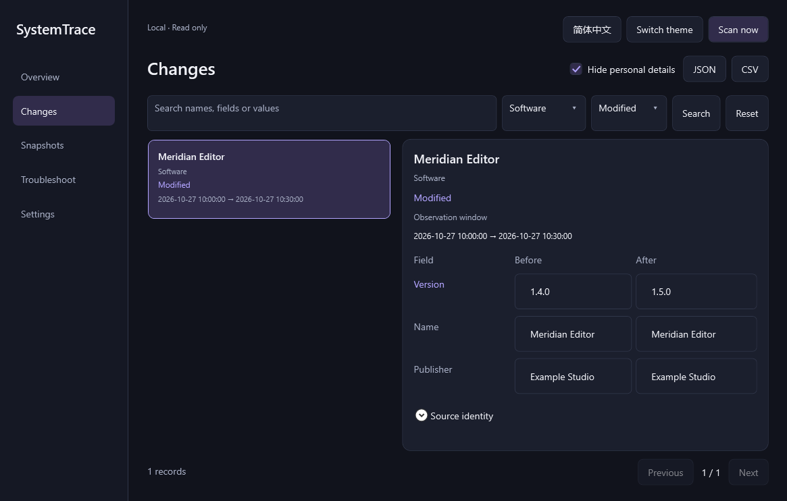
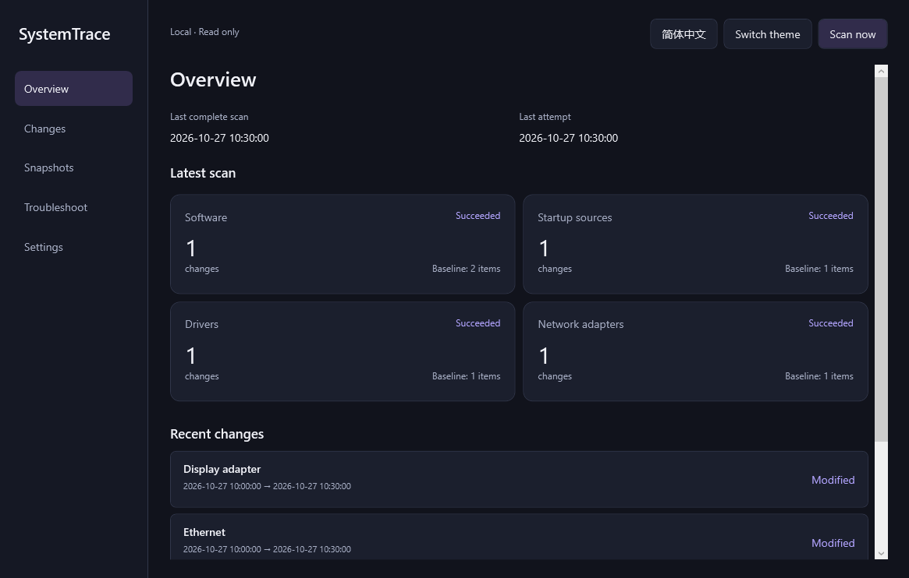

# SystemTrace

[English](README.md) · [下载](https://github.com/Morris233/systemtrace/releases/latest) · [隐私](docs/PRIVACY.md) · [贡献](CONTRIBUTING.md)

本地记录 Windows 软件、已监测启动来源、当前 PnP 驱动和网络适配器的变化。



## 最新更新 — v0.1.1

新增类型筛选与重置；导出覆盖同一条件下的全部记录。搜索失败时保留原列表及上次成功的导出条件。[更新记录](CHANGELOG.md) · [验收结果](docs/PHASE-07-RESULTS.md)

## 使用

支持 Windows 11 x64。从 Releases 下载 win-x64 ZIP，核对 SHA256SUMS.txt 后解压，运行 **SystemTrace.App.exe**。便携包自带 .NET 10，无需安装 SDK、安装器或管理员权限。此版本未签名。

首次点击**建立基线**，每类首次成功采集只建基线、不生成新增事件。再次扫描后记录差异；失败或部分成功保留该类上次成功基线。

## 功能

- 概览：最近完整扫描、最近尝试、分类状态和最近记录。
- 搜索分页、完整 before/after 字段和观察区间。
- 成功快照只读比较、按时间窗口回溯。
- 中英双语、深浅主题、键盘焦点及可访问名称。
- 自愿后台与托盘、暂停继续、可选登录启动、扫描进度取消。
- JSON/CSV 导出当前已应用搜索的全部页，默认隐藏个人信息。
- 历史保留、确认后删除全部记录、仅含元数据的本地诊断。



截图使用虚构测试夹具，应用没有演示模式。

## 默认设置与数据

| 设置 | 默认 |
| --- | --- |
| 后台监测 | 关闭 |
| 关闭到托盘 | 关闭 |
| 登录启动 | 关闭 |
| 启用后的扫描间隔 | 30 分钟 |
| 历史保留 | 90 天，0 为全部保留 |
| 导出隐私过滤 | 开启 |

监测设置需点击**保存**；语言与主题即时保存。未启用关闭到托盘时，关闭窗口即退出；托盘**退出**始终结束进程。再次打开程序会唤起已有窗口。暂停只停止后续定时扫描，取消用于当前尚未提交的扫描；休眠恢复后不积压补跑。

数据位于 `%LOCALAPPDATA%\SystemTrace\`：`system-v1.db`（schema 2）、`settings.json` 和有上限的 `diagnostics*.log`。打开程序只读历史，不扫描、不新建清单库；旧 schema 1 原子迁移。历史演示库不再访问，不会自动删除。

扫描后或点击**清理过期**时执行保留策略，当前基线、其必要证据和最近尝试可能早于保留期。**删除全部记录**需确认，下次成功扫描重新建基线；不会删除外部导出或备份。

应用不联网、不上传遥测，不执行采集到的命令。只有用户启用登录启动时才管理命令精确匹配的自身当前用户启动值。网卡历史不含 IP、MAC、SSID、密码。导出默认隐藏名称、标识、命令和路径；原始导出另行确认。详见[隐私说明](docs/PRIVACY.md)。

## 边界

软件采集不覆盖便携和部分 Store 应用；启动来源不覆盖任务、服务和其他用户。设备“未检测到”不等于卸载；网卡运行状态不等于管理启用状态。观察区间不代表确切发生时间或故障原因。

已验证 100/150/200% 渲染缩放；实际跨显示器 DPI、完整人工读屏、注销再登录和第三方软件安装实验未执行。运行时隔离验证不冒充全新虚拟机认证。参见 [T001–T026](docs/TEST-PLAN.md) 与[第六阶段报告](docs/PHASE-06-RESULTS.md)。

## 构建与验证

Windows 11 x64、微软官方 .NET 10 SDK；打包需要 PowerShell 7。

```powershell
dotnet restore --locked-mode
dotnet build --configuration Release --no-restore
dotnet test --configuration Release --no-build --logger trx
dotnet format --verify-no-changes --no-restore
dotnet run --project src/SystemTrace.App
./scripts/Build-Portable.ps1
```

打包脚本使用独立 win-x64 锁定依赖，自包含发布、复制依赖许可、验证运行时隔离及进程退出，然后生成 ZIP、SHA256SUMS.txt 和 BUILD-INFO.json。正常构建与发布锁文件分开。测试只修改自己的随机键和临时目录，SYSTEMTRACE_DATA_DIR 用于隔离测试进程。

详见[依赖](docs/THIRD-PARTY.md)、[发布流程](docs/RELEASING.md)与[贡献](CONTRIBUTING.md)。

AGENTS、PRODUCT、PHASES 来自用户下载文档；PRODUCT 保留原需求，PHASES 追加授权的维护迭代，AGENTS 增补用户的简洁 UI 准则。未取得的设计原稿由明确标识的开发说明补充，不声称恢复缺失原文。各阶段记录保存在 docs/PHASE-01-RESULTS.md 至 docs/PHASE-07-RESULTS.md。

MIT 许可证；第三方组件保留各自声明。
